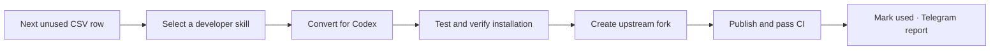

<div align="center">

# 🧩 CODEX SKILL LAB

### Curated Claude skills. Rebuilt for Codex. Published for developers.

[](registry/claude_only_skills_with_stars.csv)
[](docs/daily-workflow.md)
[](docs/daily-workflow.md)
[](https://github.com/gkmraju/codex-skill-creator/actions/workflows/validate.yml)

[Source queue](registry/claude_only_skills_with_stars.csv) · [Workflow](docs/daily-workflow.md) · [Current checkpoint](STATUS.md) · [Telegram](docs/telegram.md)

</div>

---

## One queue. One workflow. One schedule.

Work through the manually curated CSV **from top to bottom**. Pick the next unused row, recreate one selected skill for Codex, and publish it in an actual upstream fork containing the converted skill and its supporting resources.

The queue is already screened by the user. Its original order and approximate star counts are preserved.



## What happens each day

| Stage | Result |
| :--- | :--- |
| **Pick** | One pending or resumable row; no repeated discovery |
| **Convert** | Codex instructions, working resources and installation |
| **Verify** | License/provenance, actual behavior and release evidence |
| **Fork & publish** | gkmraju/codex-skill-<slug>, source lineage retained, successful CI |
| **Record** | Durable queue progress and a compact Telegram report |

A row becomes **completed only after publication and successful CI**. Interrupted work resumes from its checkpoint. Unsuitable or blocked sources retain their reasons.

## Run locally

Python 3.10+ is required for the queue and conversion tooling.

```text
python -m pip install -r requirements.txt
python -B scripts/next_candidate.py next
```

Start the selected row with its actual skill path:

```text
python -B scripts/next_candidate.py mark 2 in-progress --skill-path skills/example
```

After the conversion gates, real fork publication and CI pass:

```text
python -B scripts/next_candidate.py mark 2 completed --candidate source-skill-id --publication evidence/publication/example.json
```

See the [workflow](docs/daily-workflow.md) for skipped/blocked rows and publication details.

## A small, durable workspace

| Path | Purpose |
| :--- | :--- |
| [registry/claude_only_skills_with_stars.csv](registry/claude_only_skills_with_stars.csv) | Original 154-source queue |
| [registry/queue-state.json](registry/queue-state.json) | Used, skipped, blocked and resumable rows |
| [registry/queue-policy.json](registry/queue-policy.json) | Accepted screening and CSV fingerprint |
| [registry/candidates.json](registry/candidates.json) | Current conversion and evidence ledger |
| migrations/ | Reviewed single-skill packages |
| reports/ | Concise current run reports |
| [archive/](archive/README.md) | Recoverable historical work; excluded from daily context |

## Built to spend fewer tokens

A **fresh standalone run at 07:00 IST** reads one queue row and a small checkpoint. No broad discovery, star refresh or fresh Codex-equivalence search. Scripts handle repeatable mechanics; tests focus on changed behavior, and independent evaluation is reserved for meaningful complexity.

The schedule uses the existing configured model with medium reasoning. Each run stops after one successful skill. A daily release is a target; unfinished work is reported honestly.

## Telegram delivery

Keep credentials in the ignored .env.telegram file. The existing **CODEX SKILL LAB** report includes the skill, developer benefit, essential verification, measured duration and repository link.

[Template and sender](skill_migration/telegram.py) · [Configuration](docs/telegram.md)

## Verification

```text
python -B scripts/verify.py
```

Control-project tests check queue progression, validation, evidence and reporting. Each converted skill also needs its own behavioral/install checks and successful CI.

Source authors retain attribution. Applicable licenses and immutable source revisions accompany every derivative. Historical work is preserved in the [archive](archive/README.md).

Every published skill gets the same README polish: [README standard](docs/skill-readme.md) · [Reusable template](templates/skill-repository-readme.md).
