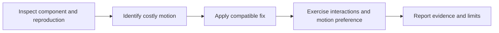

<div align="center">

# 🧩 Codex Animation Performance

### Diagnose costly web motion and preserve interactive behavior.

[](skills/animation-performance/SKILL.md)
[](LICENSE)
[](https://github.com/gkmraju/codex-skill-animation-performance/actions/workflows/validate.yml)

[Quick start](#quick-start) · [Example](#example) · [Verification](#verification) · [Upstream](#upstream--license)

</div>

---

## What this skill helps you do

Find expensive animated properties, busy-main-thread motion and per-frame rendering. Apply a focused fix when requested, or produce a scoped audit. Preserve geometry, layout, keyboard/pointer behavior, focus and reduced-motion preferences.

| Developer task | Skill behavior |
| :--- | :--- |
| Diagnose stutters | Explain code/trace evidence and the suspected rendering cost |
| Fix a component | Keep intended design and interactions while changing the costly mechanism |
| Review motion | Separate static risks from measured performance |

## Quick start

Copy the entire skills/animation-performance folder into your project's .agents/skills directory. The optional installer requires Python 3.10+ and an existing project directory:

```text
git clone https://github.com/gkmraju/codex-skill-animation-performance
cd codex-skill-animation-performance
python -B skills/animation-performance/scripts/install.py --project PATH_TO_EXISTING_PROJECT
```

The installer refuses an existing skill instead of overwriting it. Restart Codex if a newly installed skill is not discovered. Browser tools are optional; use the tools available in your project.

Invoke in Codex:

```text
$animation-performance Fix this card's janky movement, preserving its final layout, keyboard behavior and reduced-motion preference.
```

## Example

The [before fixture](skills/animation-performance/examples/before.html) animates an interactive card through a layout property and transition:all. The [after fixture](skills/animation-performance/examples/after.html) demonstrates the correction exercised during independent evaluation.

These are controlled examples. Desktop/headless observations do not establish real-phone smoothness or an application-wide frame rate.

## How it works



## Verification

```text
python -B -m unittest discover -s skills/animation-performance/tests -v
npm install --no-save playwright@1.62.1
npx playwright install chromium
node skills/animation-performance/tests/browser.cjs
```

The installer checks complete copying, missing-project rejection and overwrite protection. Three browser scenarios exercise geometry, pointer/keyboard activation, focus and reduced motion, while recording scoped layout metrics. CI runs these checks; consult Actions for actual outcomes.

See [evaluation](docs/evaluation.md) for native Codex discovery, independent instruction-following results and measurement limits. Optional Playwright developer tests are separate from using this instruction skill.

## Scope

Web CSS/JavaScript/React animation diagnosis. Keep existing libraries and design choices unless a change is needed. No guaranteed GPU acceleration, FPS target, React Native diagnosis or physical-device acceptance. Source-only reviews disclose missing runtime evidence.

## Upstream & license

Adapted from [Emil Kowalski's animation-performance skill](https://github.com/emilkowalski/skills/blob/2d228630ba1446365f614a108cb8252f1feda202/skills/animation-performance/SKILL.md).

Source revision: 2d228630ba1446365f614a108cb8252f1feda202 · [MIT notice](LICENSE).

Copyright (c) 2026 Emil Kowalski. Maintained by gkmraju with disclosed Codex assistance. No source-author endorsement or measured adoption is claimed.

[Provenance](provenance.json) · [Attribution](UPSTREAM.md) · [Migration](docs/migration.md) · [Compatibility](docs/compatibility.md) · [Evaluation](docs/evaluation.md)
